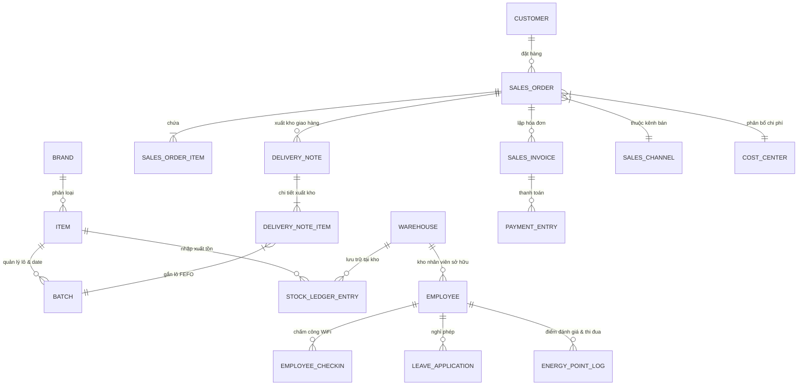

# THIẾT KẾ MÔ HÌNH DỮ LIỆU (ERP DATA MODEL)
**Dự án:** Hệ thống ERP Phân phối Thực phẩm Bảo vệ Sức khỏe (BAKAERP)  
**Nhãn hàng:** PLUS, CACAO, TIBOKA  
**Cơ sở dữ liệu:** MariaDB 10.6  

---

## 1. Sơ đồ Quan hệ Thực thể Tổng thể (ERD)

---

## 2. Chi tiết các Thực thể Dữ liệu Trọng yếu

### 2.1. Phân hệ Danh mục Sản phẩm & Lô hàng
- **DocType `Brand`:**
  - `name`: Tên nhãn hàng (`PLUS`, `CACAO`, `TIBOKA`).
  - `brand`: Tên hiển thị.
  - `description`: Mô tả phân khúc nhãn hàng (Cao cấp, Hương vị, Đại trà).
- **DocType `Item`:**
  - `item_code`: Mã sản phẩm duy nhất (`TBK-PLUS`, `TBK-CACAO`, `TBK-TIBOKA`).
  - `item_name`: Tên đầy đủ của sản phẩm.
  - `brand`: Liên kết đến `Brand`.
  - `has_batch_no`: `1` (bắt buộc quản lý theo số lô).
  - `create_new_batch`: `1` (tự động gợi ý/tạo số lô khi nhập kho).
  - `has_expiry_date`: `1` (bắt buộc có hạn sử dụng).
  - `shelf_life_in_days`: `730` (24 tháng).
  - `stock_uom`: `Hộp`.
  - `standard_rate`: Giá niêm yết bán lẻ VND (365.000, 265.000, 250.000).
  - `valuation_rate`: Giá vốn cơ sở (200.000, 150.000, 140.000).
- **DocType `Batch`:**
  - `name` / `batch_id`: Mã định danh lô (Ví dụ: `LOT-PLUS-202610-01`, `LOT-CACAO-202610-01`, `LOT-TIBOKA-202610-01`).
  - `item`: Mã sản phẩm.
  - `manufacturing_date`: Ngày sản xuất (Date).
  - `expiry_date`: Hạn sử dụng (Date) - Căn cứ cốt lõi để xuất kho theo phương pháp FEFO.
  - `disabled`: `0`/`1` (Khóa lô khi quá hạn hoặc cách ly hỏng).

### 2.2. Phân hệ Kho vận & Điều chuyển Nội bộ
- **DocType `Warehouse`:**
  - `warehouse_name`: Tên kho.
  - `parent_warehouse`: Cây kho mẹ (`All Warehouses - B`).
  - `is_group`: `0` (kho trực tiếp) hoặc `1` (kho nhóm).
  - `custom_warehouse_type`: `Central` (Kho tổng), `Employee` (Kho di động của NVKD), `Quarantine` (Kho cách ly & kiểm định), `Damaged` (Kho hàng hỏng & hết hạn).
  - `custom_employee`: Mã nhân viên phụ trách kho (đối với kho nhân viên).
- **DocType `Stock Entry`:**
  - `stock_entry_type`:
    - `Material Receipt`: Nhập kho ban đầu hoặc nhập thành phẩm sản xuất.
    - `Material Transfer`: Điều chuyển bàn giao từ Kho Tổng sang Kho Nhân Viên (KHÔNG sinh doanh thu, KHÔNG công nợ).
    - `Material Issue`: Xuất hủy hàng hỏng, hàng hết hạn (hạch toán chi phí tổn thất `811`).
  - `from_warehouse`, `to_warehouse`.
  - `items`: Danh sách sản phẩm, số lượng, `batch_no`, đơn giá vốn.

### 2.3. Phân hệ Bán hàng Đa Kênh & CRM
- **DocType `Customer`:**
  - `customer_name`: Tên khách hàng / Đại lý.
  - `customer_group`: `Đại lý`, `Khách hàng cuối`, `Khách hàng Sàn TMĐT`.
  - `territory`: Địa bàn phân phối (Miền Bắc, Miền Nam, Miền Trung).
  - `custom_credit_limit`: Hạn mức nợ tối đa (VND).
  - `custom_payment_terms_days`: Thời hạn nợ (ví dụ: 15 ngày, 30 ngày).
  - `custom_sales_person`: NVKD phụ trách (liên kết với `User` / `Employee`).
- **DocType `Sales Order`:**
  - `customer`: Khách hàng đặt mua.
  - `custom_sales_channel`: Kênh bán hàng (`TikTok Shop`, `Shopee`, `B2B Sỉ`, `B2C Trực tiếp`, `Website`).
  - `custom_marketplace_order_id`: Mã đơn hàng của sàn TMĐT (được đánh chỉ mục duy nhất để chống trùng).
  - `custom_platform_fee`: Phí sàn khấu trừ (VND).
  - `custom_shipping_fee`: Phí vận chuyển do nhà bán hàng chịu (VND).
  - `set_warehouse`: Kho xuất hàng (Kho Tổng đối với sỉ/sàn/web; Kho Nhân Viên đối với bán lẻ B2C trực tiếp).
  - `order_type`: `Sales`.
- **DocType `Delivery Note` & `Sales Invoice`:**
  - Kế thừa các trường kênh bán, mã đơn sàn và kho từ `Sales Order`.
  - Chọn lô xuất hàng tuân thủ quy tắc FEFO (`batch_no` có hạn sử dụng gần nhất).

### 2.4. Phân hệ Tài chính & Kế toán Quản trị
- **DocType `Account`:**
  - `1111`: Tiền mặt Việt Nam (VND).
  - `1121`: Tiền gửi ngân hàng (VND).
  - `1311`: Phải thu khách hàng trong nước (Công nợ đại lý B2B).
  - `1411`: Tiền thu hộ của NVKD (Khoản tiền mặt/chuyển khoản NVKD thu từ khách lẻ trực tiếp, chờ nộp về công ty).
  - `155`: Thành phẩm tồn kho (Giá trị tồn tại Kho tổng và Kho nhân viên).
  - `5111`: Doanh thu bán hàng hóa.
  - `5211`: Chiết khấu thương mại.
  - `5213`: Hàng bán bị trả lại.
  - `632`: Giá vốn hàng bán (COGS).
  - `6411`: Chi phí nhân viên bán hàng.
  - `6412`: Chi phí bao bì, vận chuyển.
  - `6413`: Phí sàn thương mại điện tử (Shopee, TikTok Shop).
  - `6414`: Chi phí quảng cáo, marketing (Facebook, TikTok Ads).
  - `6421`: Chi phí nhân viên quản lý.
  - `6426`: Chi phí thuê mặt bằng, văn phòng, kho bãi.
- **DocType `Cost Center`:**
  - Quản lý lãi lỗ đa chiều theo Kênh bán (`Shopee`, `TikTok Shop`, `B2B Sỉ`, `B2C Trực tiếp`, `Website`) và Nhãn hàng (`PLUS`, `CACAO`, `TIBOKA`).

### 2.5. Phân hệ Nhân sự, Chấm công & KPI
- **DocType `Employee`:**
  - Thông tin định danh nhân sự, chức danh, phòng ban, người dùng liên kết (`user_id`).
- **DocType `Employee Checkin`:**
  - Ghi nhận lịch sử quẹt thẻ WiFi: `log_type` (IN/OUT), `time`, `ip_address`, `wifi_ssid`, `status`.
- **DocType `Energy Point Log`:**
  - Điểm đánh giá thi đua, ghi nhận thành tích bán hàng và KPI của nhân sự.
- **DocType `Leave Application`:**
  - Đơn xin nghỉ phép, thời gian nghỉ, lý do, người phê duyệt (`coo@baka.vn`).
