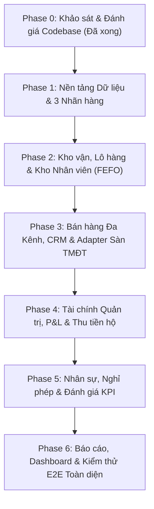

# KẾ HOẠCH TRIỂN KHAI NÂNG CẤP ERP (ERP IMPLEMENTATION PLAN)
**Dự án:** Hệ thống ERP Phân phối Thực phẩm Bảo vệ Sức khỏe (BAKAERP)  
**Nhãn hàng:** PLUS, CACAO, TIBOKA  
**Kênh bán:** TikTok Shop, Shopee, Đại lý B2B, Bán lẻ B2C trực tiếp, Website  

---

## 1. Mục tiêu kiến trúc & Nguyên tắc cốt lõi

### 1.1. Nguyên tắc Ponytail (Minimal & High Efficiency)
- **Tối đa hóa tính năng chuẩn của Frappe & ERPNext v15:** Tận dụng triệt để các DocType và Engine có sẵn như `Brand`, `Item`, `Batch`, `Warehouse`, `Stock Entry`, `Sales Order`, `Delivery Note`, `Sales Invoice`, `Payment Entry`, `Cost Center`, `Leave Application`, `Employee Checkin`.
- **Tuyệt đối không đập đi xây lại:** Kế thừa 100% phân hệ Chấm công WiFi, tính điểm chuyên cần theo năm, biểu đồ heatmap và cơ chế bảo mật WiFi đã chạy ổn định tại `user-profile`.
- **Không cài thêm thư viện cồng kềnh:** Sử dụng các thư viện có sẵn (Python tiêu chuẩn, Frappe ORM, Chart.js, SQL MariaDB tối ưu).

### 1.2. Nguyên tắc toàn vẹn dữ liệu tài chính & kho vận
- **Chặn tồn kho âm:** Thiết lập `allow_negative_stock = 0`.
- **FEFO (First Expired, First Out):** Xuất kho bắt buộc chọn theo hạn sử dụng của từng lô hàng.
- **Rõ ràng giữa điều chuyển và bán hàng:** Bàn giao hàng sang kho nhân viên sử dụng `Material Transfer`, không tạo doanh thu và không tạo công nợ; chỉ khi xuất bán cho khách mới ghi nhận doanh thu và giảm tồn kho nhân viên.
- **Đối soát tiền thu hộ:** Tiền bán lẻ nhân viên thu được theo dõi riêng tại tài khoản tạm ứng/thu hộ, chỉ tất toán khi nhân viên nộp tiền về ngân hàng hoặc quỹ tiền mặt công ty.
- **Chống trùng đơn sàn:** Khóa Unique Index trên mã đơn sàn (`marketplace_order_id`) khi import đơn Shopee / TikTok Shop.

---

## 2. Lộ trình Triển khai Chi tiết theo từng Giai đoạn

---

### Giai đoạn 1 (Phase 1): Nền tảng Dữ liệu, 3 Nhãn hàng & Phân quyền
1. **Thiết lập 3 Nhãn hàng (`Brand`):**
   - `PLUS`: Dòng sản phẩm cao cấp tăng cường lợi khuẩn và đề kháng chuyên sâu.
   - `CACAO`: Dòng sản phẩm hương vị ca cao tự nhiên thơm ngon.
   - `TIBOKA`: Dòng sản phẩm dinh dưỡng đại trà tiếp cận phổ thông.
2. **Cập nhật 3 Sản phẩm (`Item`):**
   - Gán `brand` tương ứng: `TBK-PLUS` $\rightarrow$ PLUS, `TBK-CACAO` $\rightarrow$ CACAO, `TBK-TIBOKA` $\rightarrow$ TIBOKA.
   - Kích hoạt quản lý lô và hạn sử dụng: `has_batch_no = 1`, `create_new_batch = 1`, `has_expiry_date = 1`, `shelf_life_in_days = 730` (2 năm).
   - Thiết lập bảng giá chuẩn Standard Selling (VND).
3. **Bổ sung Custom Fields cần thiết:**
   - `sales_channel` trên `Sales Order`, `Sales Invoice`: `[TikTok Shop, Shopee, B2B Sỉ, B2C Trực tiếp, Website]`.
   - `marketplace_order_id` trên `Sales Order`: Lưu mã đơn Shopee/TikTok chống trùng.
   - `platform_fee` & `shipping_fee_paid` trên `Sales Order` / `Sales Invoice`: Lưu chi phí sàn và phí ship do người bán chịu.
   - `assigned_sales_user` trên `Customer` và `Sales Order`: Gán nhân viên kinh doanh phụ trách.

---

### Giai đoạn 2 (Phase 2): Kho Vận, Lô Hàng FEFO & Kho Nhân Viên Di Động
1. **Cấu trúc Cây Kho BAKA:**
   - `Kho Tổng BAKA - B` (Kho trung tâm lưu trữ thành phẩm nhập từ xưởng/sản xuất).
   - Nhóm `Kho Nhân Viên - B` (Nhóm kho di động):
     - `Kho NVKD - Nguyễn Văn Nam - B` (Kho của `sale1@baka.vn`).
     - `Kho NVKD - Trần Thị Mai - B` (Kho của `sale2@baka.vn`).
   - `Kho Cách Ly & Đổi Trả - B` (Tiếp nhận hàng đổi trả từ khách hàng/sàn để phân loại thẩm định).
   - `Kho Hàng Hỏng & Hết Hạn - B` (Chứa hàng lỗi, bao bì rách, hàng quá hạn chờ hủy).
2. **Quy trình Lô & Hạn Sử Dụng (FEFO):**
   - Tạo các Lô hàng thực tế với các hạn sử dụng khác nhau (ví dụ: Lô tháng 06/2027, Lô tháng 12/2027, Lô cận date 11/2026).
   - Hệ thống tự động ưu tiên xuất các lô có hạn sử dụng gần nhất trước.
3. **Quy trình Bàn giao hàng sang Kho Nhân viên:**
   - Dùng chứng từ `Stock Entry` (loại `Material Transfer`).
   - Nguồn: `Kho Tổng BAKA - B` $\rightarrow$ Đích: `Kho NVKD - [Tên Sale] - B`.
   - Kiểm tra: Không tạo hạch toán doanh thu hay công nợ, chỉ chuyển quyền quản lý vật chất hàng tồn.
4. **Quy trình Xử lý Hàng Đổi Trả / Hỏng:**
   - Đơn trả hàng $\rightarrow$ Nhập vào `Kho Cách Ly & Đổi Trả - B`.
   - Kiểm tra chất lượng:
     - Đạt chuẩn $\rightarrow$ Điều chuyển về `Kho Tổng BAKA - B`.
     - Hỏng/Lỗi $\rightarrow$ Điều chuyển sang `Kho Hàng Hỏng & Hết Hạn - B` và xuất hủy chi phí (Stock Entry: Damaged Goods Issue hạch toán vào tài khoản chi phí khác `811`).

---

### Giai đoạn 3 (Phase 3): Bán Hàng Đa Kênh & CRM Quản Lý Khách Hàng
1. **Kênh 1: Bán sỉ B2B (Đại lý & Nhà phân phối):**
   - Đơn hàng sỉ giá chiết khấu, xuất từ `Kho Tổng BAKA - B`.
   - Cấu hình hạn mức công nợ (Credit Limit) và thời hạn thanh toán (Payment Terms: 15-30 ngày).
   - Hỗ trợ thanh toán nhiều lần cho một hóa đơn phải thu qua `Payment Entry`.
2. **Kênh 2: Bán lẻ trực tiếp B2C:**
   - NVKD gặp khách trực tiếp, bán hàng và xuất kho trực tiếp từ `Kho NVKD - [Tên Sale] - B`.
   - Thu tiền mặt hoặc khách chuyển khoản $\rightarrow$ Ghi nhận thanh toán vào tài khoản `1411 - Tiền thu hộ của NVKD`.
3. **Kênh 3 & 4: TikTok Shop & Shopee (Sàn TMĐT):**
   - Module tiếp nhận / import đơn sàn (Data Adapter) nhận file CSV/JSON hoặc dữ liệu đơn.
   - Cơ chế tự động đối chiếu `marketplace_order_id`: Nếu đơn đã tồn tại trong hệ thống, lập tức từ chối/bỏ qua, tránh tạo đơn hoặc xuất kho hai lần.
   - Ghi nhận đầy đủ: Tiền hàng khách trả, Phí sàn khấu trừ, Phí vận chuyển, Số tiền quyết toán thực tế về tài khoản ngân hàng.
4. **Kênh 5: Bán hàng qua Website:**
   - Đơn hàng đặt qua web, xuất kho tổng, thanh toán COD hoặc chuyển khoản ngân hàng.
5. **Quản lý Đại lý / CRM:**
   - Gán người phụ trách thị trường (`Sales Person` / `Owner`).
   - Bảng theo dõi lịch sử mua hàng, công nợ lũy kế và kỳ hạn thanh toán.

---

### Giai đoạn 4 (Phase 4): Tài Chính Quản Trị & Báo Cáo Lãi Lỗ (P&L)
1. **Cây Cost Center Quản Trị:**
   - `BAKA - B`
     - Phân theo Kênh: `Kênh TikTok Shop - B`, `Kênh Shopee - B`, `Kênh B2B Sỉ - B`, `Kênh B2C Lẻ - B`, `Kênh Website - B`.
     - Phân theo Nhãn hàng: `Nhãn hàng PLUS - B`, `Nhãn hàng CACAO - B`, `Nhãn hàng TIBOKA - B`.
     - Chi phí Vận hành chung: `Khối Quản Lý & Văn Phòng - B`, `Khối Kho Vận - B`.
2. **Tài khoản Kế toán Bổ sung:**
   - `1411 - Tiền thu hộ của NVKD - B` (Tài khoản theo dõi tiền mặt/chuyển khoản do NVKD tạm giữ).
   - `6413 - Phí sàn thương mại điện tử - B` (Phí dịch vụ TikTok/Shopee).
   - `6414 - Chi phí quảng cáo & marketing - B` (Chi phí Ads Facebook, TikTok, Shopee).
   - `6426 - Chi phí thuê văn phòng, kho bãi - B`.
3. **Quy trình Đối soát Thu tiền hộ:**
   - NVKD nộp tiền về công ty $\rightarrow$ Bút toán `Payment Entry` (Internal Transfer) từ `1411` sang `1121` (Ngân hàng) hoặc `1111` (Tiền mặt công ty). Số dư trên `1411` của từng nhân viên phản ánh chính xác số tiền còn phải nộp.
4. **Báo cáo Lãi Lỗ Quản Trị (Managerial P&L Report):**
   - Xây dựng API và báo cáo trực quan bóc tách:
     $$\text{Lợi nhuận gộp} = \text{Doanh thu thuần} - \text{Giá vốn (COGS)}$$
     $$\text{Lợi nhuận ròng quản trị} = \text{Lợi nhuận gộp} - \text{Phí sàn} - \text{Phí vận chuyển} - \text{Chi phí Ads} - \text{Lương} - \text{Chi phí vận hành}$$
   - Lọc và nhóm linh hoạt theo: Nhãn hàng (PLUS, CACAO, TIBOKA) và Kênh bán (5 kênh).

---

### Giai đoạn 5 (Phase 5): Nhân Sự, Nghỉ Phép & Đánh Giá KPI
1. **Bảo tồn phân hệ Chấm công WiFi:**
   - Giữ nguyên toàn bộ logic đã kiểm thử trong `wifi_attendance.py` và `wifi_attendance.js`.
2. **Nghỉ phép (Leave Management):**
   - Đảm bảo nhân viên gửi đơn xin nghỉ phép (`Leave Application`), cấp quản lý (COO) phê duyệt. Ngày nghỉ có phép không bị tính là vắng mặt không phép.
3. **Tính KPI & Điểm Đánh Giá:**
   - Tự động cộng Điểm đánh giá (Energy Points) khi hoàn thành xuất sắc chỉ tiêu:
     - Tạo và chốt đơn sỉ lớn.
     - Mở mới đại lý thành công.
     - Thu hồi công nợ đúng hạn.
   - Thống kê KPI theo tháng cho từng nhân sự và xếp hạng Leaderboard.

---

### Giai đoạn 6 (Phase 6): Dashboards & Kiểm Thử Toàn Diện (End-to-End Test Suite)
1. **Xây dựng Dashboards chuyên biệt:**
   - **Dashboard Ban Giám Đốc:** P&L quản trị thời gian thực, doanh thu theo kênh/nhãn hàng, công nợ tổng thể, cảnh báo hạn sử dụng.
   - **Dashboard Quản Lý Kho:** Tồn kho theo lô và hạn dùng, cảnh báo cận date (< 60 ngày), hàng đang nằm tại kho nhân viên, hàng cách ly đổi trả.
   - **Dashboard Kinh Doanh:** Doanh số từng NVKD, đại lý mới, công nợ theo từng NVKD phụ trách.
   - **Dashboard Nhân Viên (My Profile):** Giữ nguyên trải nghiệm chấm công WiFi, điểm chuyên cần, thêm danh mục hàng tồn trong kho di động của bản thân.
2. **Bộ kiểm thử tự động (Automated Test Suite):**
   - Viết kịch bản kiểm thử tự động toàn diện `erpnext/setup/health_food_erp_test.py` xác minh từng mục trong Section 18 của `prompt.md`.
   - Kiểm tra tính toán đối chiếu độc lập với bộ dữ liệu mẫu có đáp số xác thực.
